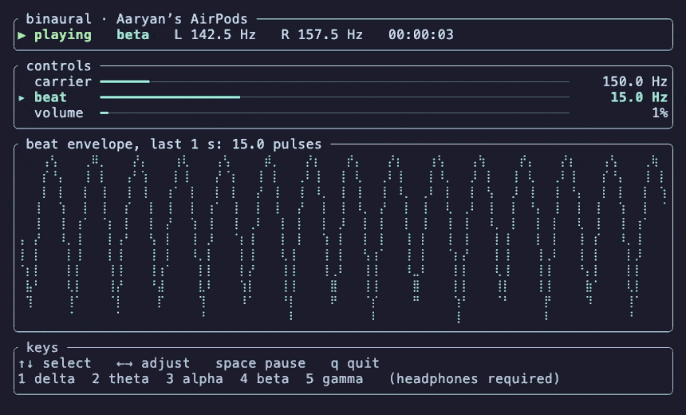
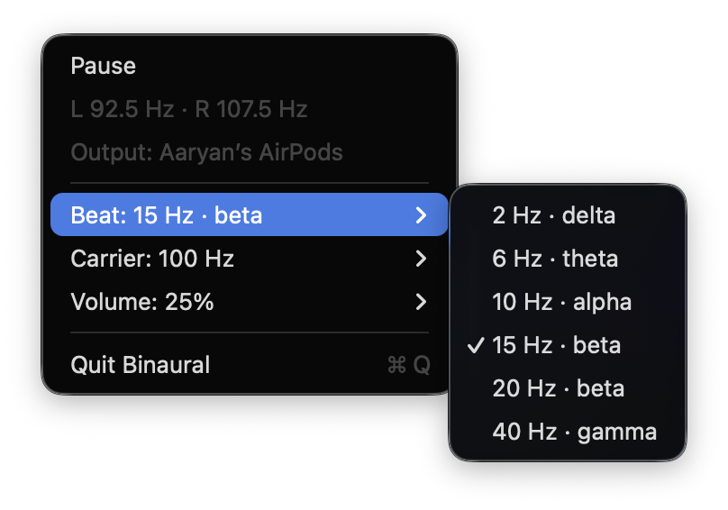

# binaural

A binaural beat generator for macOS, written in Rust. It comes as a terminal app and a menu bar app that share the same audio engine.

A binaural beat plays a slightly different tone in each ear, for example 142.5 Hz on the left and 157.5 Hz on the right. You hear the 15 Hz difference as a slow pulse that exists only in your head, so **headphones are required**.

## Terminal app



```bash
cargo run --release -- --carrier 150 --beat 15 --volume 20
```

| Key | Action |
|---|---|
| `↑` `↓` or `k` `j` | Select carrier, beat or volume |
| `←` `→` or `h` `l` | Adjust the selected value |
| `1`–`5` | Beat presets: delta 2 Hz, theta 6 Hz, alpha 10 Hz, beta 20 Hz, gamma 40 Hz |
| `space` | Pause or resume |
| `q`, `Esc` or `Ctrl-C` | Quit |

Options, also shown by `--help`:

| Option | Range | Default |
|---|---|---|
| `--carrier HZ` | 50 to 1000: the tone midway between the ears | 150 |
| `--beat HZ` | 0.5 to 50: the difference between the ears | 10 |
| `--volume PCT` | 0 to 100 | 25 |

The envelope panel scrolls in real time across the last second, so a 15 Hz beat shows 15 pulses.

## Menu bar app

```bash
scripts/bundle.sh
open target/Binaural.app
```

`bundle.sh` builds `target/Binaural.app`, a background app with no Dock icon. Copy it to `/Applications` and add it under System Settings > General > Login Items to start it at login.



The menu bar shows `∿` when idle, `∿ 15 Hz` while playing and `∿ !` after a failure, with the error text inside the menu.

- It starts paused at the defaults each time it launches.
- Pause fades out and closes the audio stream, so a paused app does no audio work and the output device can go idle.
- If the system output switches, for example when AirPods disconnect, it pauses instead of moving the tone to the laptop speakers. The terminal app does the same.

On one Apple silicon Mac playing to AirPods, it used about 0.4% of one CPU core and an 18 MB memory footprint. macOS's `coreaudiod` used more than that to encode Bluetooth audio, which any app playing to AirPods pays.

## How it works

- Each ear gets a sine wave: the carrier minus half the beat on the left, plus half on the right. Phases are continuous, and frequency and volume glide to new values over about 50 ms, so changes do not click.
- The audio callback reads its targets from atomics and never takes a lock.
- [cpal](https://github.com/RustAudio/cpal) drives CoreAudio. The menu bar app calls AppKit directly through [objc2](https://github.com/madsmtm/objc2), and the terminal app uses [ratatui](https://ratatui.rs).
- Code layout: `src/lib.rs` holds the shared synth, audio, settings and logging; `src/main.rs` is the terminal app; `src/bin/binaural-bar/` is the menu bar app.

## Logs

Each run appends to a timestamped file in this repository's `logs/` folder. Set `LOG_LEVEL` to `DEBUG`, `INFO` (default), `WARN` or `ERROR`; `DEBUG` also records every setting change.

## Does it work?

The evidence is mixed. Two meta-analyses report medium-sized effects on attention and memory: [Garcia-Argibay et al., 2019](https://pubmed.ncbi.nlm.nih.gov/30073406/) (g = 0.45 across 22 studies) and [Basu & Banerjee](https://pubmed.ncbi.nlm.nih.gov/35842538/) (g = 0.40), though the latter found conflicting results at theta and beta frequencies. A [2023 review of EEG studies](https://www.ncbi.nlm.nih.gov/pmc/articles/PMC10198548/) found 5 of 14 supporting brainwave entrainment, 8 contradicting it and 1 mixed. The band names in this app are EEG labels, not claims about effects. Treat it as an experiment on yourself.

## Development

```bash
cargo fmt --check
cargo clippy --all-targets -- -D warnings
cargo test
```

Requires macOS and Rust 1.88 or newer.

## License

[MIT](LICENSE)
